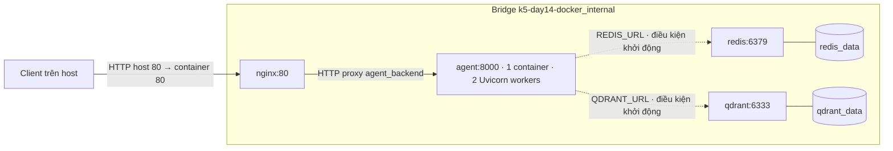
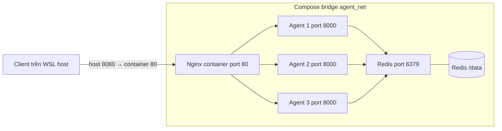

# Day 14 Lab - Mission Answers

## Part 1: Localhost vs Production

### Exercise 1.1: Anti-patterns found

Các đường dẫn trong bảng tính từ `01-localhost-vs-production/`.

| ID | Anti-pattern | Develop | Rủi ro | Production |
|---|---|---|---|---|
| A1 | Ghi cứng key và URL DB chứa thông tin xác thực | `develop/app.py:15–18` | Secret thật sẽ xuất hiện trong mã nguồn và lịch sử Git. Người có key có thể dùng tài khoản hoặc làm phát sinh chi phí. Các giá trị mẫu hiện tại chỉ minh họa rủi ro. | `production/config.py:26–32,37–50` đọc key từ môi trường và kiểm tra cấu hình. App mẫu dùng mock, không có kết nối DB. |
| A2 | Ghi cứng host và cổng | `develop/app.py:45–53` | Loopback giới hạn kết nối từ ngoài container. Cổng cố định có thể lệch cổng nền tảng cấp. | `production/config.py:16–19` và `production/app.py:194–198` đọc `HOST` và `PORT`. |
| A3 | Bật reload cố định | `develop/app.py:49–54` | Tiến trình giám sát file có thể khởi động lại worker khi file thay đổi. `DEBUG=True` ở dòng 21 chỉ là hằng chưa được dùng, còn `reload=True` thực sự bật. | `production/config.py:19` mặc định `DEBUG=false`. `production/app.py:194–198` chỉ bật reload khi được cấu hình. |
| A4 | Dùng print và in key, câu hỏi, câu trả lời | `develop/app.py:32–38` | Log có thể làm lộ dữ liệu và khó lọc theo sự kiện. | `production/app.py:27–32,110–122` dùng logger và ghi metadata như độ dài. Có hạn chế JSON được giải thích ở Exercise 1.3. |
| A5 | Thiếu health và readiness endpoint | `develop/app.py:25–43` | Nền tảng thiếu probe riêng để phân biệt tiến trình còn sống với khả năng nhận lưu lượng. | `production/app.py:135–161` có hai endpoint riêng. Readiness chỉ kiểm tra cờ lifecycle trong app mẫu. |
| A6 | Thiếu lifecycle cleanup của ứng dụng | `develop/app.py:13,47–54` | Khi dừng dịch vụ thật, mã ứng dụng không có điểm đóng các tài nguyên do nó tạo. Uvicorn vẫn quản lý shutdown của server. | `production/app.py:39–74,180–189` thêm lifespan với startup và cleanup mô phỏng, cùng handler ghi nhận tín hiệu. Uvicorn điều phối việc dừng server. |

### Exercise 1.2: Basic version

Theo hiệu chỉnh K5 tại `README.md`, tham số vô hướng `question: str` trong `develop/app.py:30–31` được FastAPI lấy từ query string. Lệnh gửi JSON trong Code Lab minh họa trường hợp thiếu query. Việc gọi được mock agent chỉ xác nhận luồng xử lý cơ bản. Các vấn đề A1–A6 vẫn cản trở triển khai thật.

Môi trường chạy là WSL2 kernel `6.18.58.1-microsoft-standard-WSL2`, Python `3.14.4`, `os.name == "posix"`. `fastapi==0.115.0`, `uvicorn[standard]==0.30.0` và `python-dotenv==1.0.1` được cài từ requirements production, bao gồm cả hai gói ghim của develop. Các wheel tương thích được resolver chọn, gồm Pydantic 2.14.4 và pydantic-core 2.50.5 cho CPython 3.14. `pip check` báo `No broken requirements found.` Lần cài trong sandbox không tìm thấy distribution. Lần chạy được cấp quyền tải wheel thành công. Lần khởi động thử đầu tiên hết 3 giây chờ mà chưa có log startup, nên tăng giới hạn của runner lên 30 giây rồi chạy lại.

```bash
.venv/bin/python -c 'import sys,os; print(sys.version,os.name)'
.venv/bin/python -m pip --disable-pip-version-check install --only-binary=:all: -r 01-localhost-vs-production/production/requirements.txt --retries 0 --timeout 10
.venv/bin/python -B -m pip --disable-pip-version-check check
```

Runner kiểm tra cổng bằng `socket.bind` trước và sau khi chạy. Nó dùng `.venv/bin/python -B -u app.py` với thư mục làm việc là thư mục của mỗi app, bắt riêng stdout và stderr. Với develop, runner đặt `PORT=18081 DEBUG=false` để thử config. Stderr vẫn ghi `Uvicorn running on http://localhost:8000` và `Started reloader process [4231] using WatchFiles`. Stdout ghi `[DEBUG] Got question: Hello` và `[DEBUG] Using key: [placeholder redacted]`. SIGTERM tới PID 4231 cho exit code 0, stderr xác nhận worker 4242 và reloader 4231 dừng.

### Exercise 1.3: Comparison table

| Feature | Develop | Production | Why Important? |
|---|---|---|---|
| Config | Loopback, port 8000, reload luôn bật | Env quyết định host, port, debug, tên app, môi trường và model | Có thể triển khai cùng mã trên nhiều môi trường và khớp cổng do nền tảng cấp. |
| Secrets | Literal trong mã và có log giá trị key | Đọc từ env, thiếu `AGENT_API_KEY` trong môi trường production thì từ chối khởi động | Giảm lộ secret qua Git và log. Kiểm tra lúc khởi động chỉ xác nhận có cấu hình, endpoint mẫu chưa xác thực key. |
| Health check | `/health` và `/ready` trả 404 | `/health` trả trạng thái sống, phiên bản, uptime. `/ready` báo cờ lifecycle | Liveness hỗ trợ phát hiện tiến trình lỗi. Readiness giúp bộ cân bằng tải chỉ chuyển request tới instance sẵn sàng. |
| Logging | `print()` có nội dung request và thông tin key | Logger có tên sự kiện và metadata, định dạng JSON dự kiến có lỗi | Log có trường giúp truy vấn. Collector cần từng dòng parse được và không chứa dữ liệu nhạy cảm. |
| Shutdown | Uvicorn dừng worker qua reloader. App thiếu cleanup riêng | Uvicorn hoàn thành request đang xử lý, lifespan chạy cleanup mô phỏng | Giảm gián đoạn khi triển khai lại và cho app cơ hội đóng tài nguyên. |
| API và lỗi | Query. Thiếu query trả 422 | JSON body. Thiếu câu hỏi trả 422. JSON hỏng trả 500 | Client cần hợp đồng đầu vào rõ ràng. JSON sai cú pháp là lỗi client nhưng mẫu chưa xử lý tại `request.json()`. |

**Cấu hình thử.** Runner tạo bản sao `.env.example` thành `.env` trong thư mục tạm, dùng `dotenv_values` để đọc rồi đưa biến vào môi trường tiến trình. Chỉ đặt file trong thư mục làm việc thì phép thử import settings cho `0.0.0.0 8000 development`, đúng với mặc định. Nguồn chỉ dùng `os.getenv`, nên file cần được nạp rõ ràng. Phép thử chính đặt `HOST=127.0.0.1 PORT=18081 DEBUG=false APP_NAME='CP1 Agent' ENVIRONMENT=staging`. Cổng riêng và bind loopback giữ bài thử trong máy. Phép thử thiếu key dùng `ENVIRONMENT=production AGENT_API_KEY=''`.

**Thảo luận**

1. Đưa key thật lên GitHub public cho phép người khác lấy key qua mã và lịch sử Git, gọi dịch vụ hoặc gây chi phí. Cần thu hồi key bị lộ, cấp key mới và đưa secret qua biến môi trường.
2. Stateless cho phép request kế tiếp đến instance khác hoặc tiếp tục sau restart. Nếu ứng dụng cần session, lưu vào kho chung để các instance nhìn thấy cùng dữ liệu.
3. Dev/prod parity là giữ runtime, dependency, cách chạy và dịch vụ phụ trợ đủ tương đồng để lỗi xuất hiện khi thử local. Port, credential và các giá trị theo môi trường đến từ env.

**HTTP thực đo.** Các lệnh bên dưới trình bày dạng shell tương đương với tham số runner truyền cho curl.

```bash
request() { curl --noproxy '*' -sS --max-time 3 -w '\nHTTP %{http_code}\n' "$@"; }
D=http://127.0.0.1:8000
P=http://127.0.0.1:18081
request "$D/"
request -X POST -H 'Content-Type: application/json' -d '{"question":"Hello"}' "$D/ask"
request -X POST "$D/ask?question=Hello"
for path in health ready metrics; do request "$D/$path"; done
request "$P/"
request -X POST -H 'Content-Type: application/json' -d '{"question":"Hello"}' "$P/ask"
for path in health ready metrics; do request "$P/$path"; done
request -X POST -H 'Content-Type: application/json' -d '{}' "$P/ask"
request -X POST -H 'Content-Type: application/json' -d '{' "$P/ask"
```

| Test | Request | HTTP | Body thực tế |
|---|---|---|---|
| D1 | GET develop `/` | 200 | `{"message":"Hello! Agent is running on my machine :)"}` |
| D2 | POST develop `/ask`, JSON Hello | 422 | `{"detail":[{"type":"missing","loc":["query","question"],"msg":"Field required","input":null}]}` |
| D3 | POST develop `/ask?question=Hello` | 200 | `{"answer":"Agent đang hoạt động tốt! (mock response) Hỏi thêm câu hỏi đi nhé."}` |
| D4 | GET develop `/health`, `/ready`, `/metrics` | 404 mỗi endpoint | `{"detail":"Not Found"}` |
| P1 | GET production `/` | 200 | `{"app":"CP1 Agent","version":"1.0.0","environment":"staging","status":"running"}` |
| P2 | POST production `/ask`, JSON Hello | 200 | `{"question":"Hello","answer":"Đây là câu trả lời từ AI agent (mock). Trong production, đây sẽ là response từ OpenAI/Anthropic.","model":"gpt-4o-mini"}` |
| P3 | GET production `/health` | 200 | `{"status":"ok","uptime_seconds":1.7,"version":"1.0.0","environment":"staging","timestamp":"2026-11-25T10:23:18.955811+00:00"}` |
| P4 | GET production `/ready` | 200 | `{"ready":true}` |
| P5 | GET production `/metrics` | 200 | `{"uptime_seconds":1.7,"environment":"staging","version":"1.0.0"}` |
| P6 | POST production `/ask`, body `{}` | 422 | `{"detail":"question field is required"}` |
| P7 | POST production `/ask`, body `{` | 500 | `Internal Server Error` |

Curl trả exit code 0 và stderr trống ở các request trên. Mã HTTP được thu riêng qua `-w`. Với P7, stdout server ghi `500 Internal Server Error` và stderr ghi `json.decoder.JSONDecodeError: Expecting property name enclosed in double quotes: line 1 column 2 (char 1)` tại `production/app.py:104`. Thử thiếu `AGENT_API_KEY` trong môi trường `production` cho exit code 1, stdout trống và stderr kết thúc bằng `ValueError: AGENT_API_KEY must be set in production!`.

**Logging và SIGTERM.** Lần chạy PID 4259 với key LLM trống ghi `WARNING:root:OPENAI_API_KEY not set — using mock LLM` vào stderr. Lời gọi `logging.warning` trong `config.py:40–45` khởi tạo root handler trước `logging.basicConfig` tại `app.py:28–31`, khiến INFO của app bị lọc. Để quan sát lifecycle, runner chạy lần hai với một chuỗi giữ chỗ cục bộ trong `OPENAI_API_KEY`. App vẫn gọi `utils/mock_llm.py` tại dòng 117. Khi stderr xuất hiện sự kiện `agent_request` và curl còn đang chờ, runner gửi `p.send_signal(signal.SIGTERM)` (tương đương `kill -TERM 4305`) cho tiến trình server.

```text
SIGTERM 4305 handler entered True client pending True
{"question":"Long task docker","answer":"Container là cách đóng gói app để chạy ở mọi nơi. Build once, run anywhere!","model":"gpt-4o-mini"}
HTTP 200
SIGTERM exit 0
```

Stderr của lần chạy đó, theo thứ tự:

```text
{"time":"2026-11-25 17:23:26,120","level":"INFO","msg":"{"event": "agent_request", "question_length": 16, "client_ip": "127.0.0.1"}"}
{"time":"2026-11-25 17:23:26,266","level":"INFO","msg":"{"event": "agent_response", "response_length": 75}"}
INFO:     Shutting down
INFO:     Waiting for application shutdown.
{"time":"2026-11-25 17:23:26,368","level":"INFO","msg":"Agent shutting down gracefully — finishing in-flight requests..."}
{"time":"2026-11-25 17:23:26,468","level":"INFO","msg":"Shutdown complete"}
INFO:     Application shutdown complete.
INFO:     Finished server process [4305]
{"time":"2026-11-25 17:23:26,469","level":"INFO","msg":"Received SIGTERM — initiating graceful shutdown"}
```

`json.loads` chấp nhận dòng `Shutdown complete` và từ chối các dòng sự kiện vì chuỗi JSON bên trong `msg` chứa dấu nháy chưa escape. Uvicorn hoàn thành request và chạy lifespan trước khi handler riêng ghi nhận SIGTERM. PID 4259 cũng thoát 0 khi nhận SIGTERM lúc rảnh. Runner xác nhận bind lại được cổng 8000 và 18081. `ps` sau bài thử chỉ in tiêu đề khi kiểm các PID đã ghi nhận. Phép thử xác nhận hoàn thành một request đang chạy, không đo tải đồng thời hay kiểm tra phụ thuộc của readiness.

**Kết luận.** Bản advanced thể hiện các khác biệt cần cho CP1 qua env, probe, log metadata và lifecycle. Kết quả 500 với body hỏng và lỗi JSON logging cho thấy vẫn cần xử lý thêm nếu dùng mẫu cho dịch vụ thật.

## Part 2: Docker

### Exercise 2.1: Dockerfile questions

1. **Base image:** `python:3.11`, bản đầy đủ của image Python (`02-docker/develop/Dockerfile:8`).
2. **Working directory:** `/app`. Đây là thư mục của các lệnh tiếp theo, đích tương đối của `COPY` và thư mục làm việc mặc định khi container chạy (`02-docker/develop/Dockerfile:11–24`).
3. **Thứ tự COPY:** Dòng 14 đưa riêng requirements vào build, dòng 17 cài gói, rồi các dòng 20 và 24 mới copy mã. Khi chỉ đổi mã app, Docker có thể tái sử dụng layer cài gói nếu inputs của layer và các bước trước đó còn khớp. `--no-cache-dir` tắt cache tải wheel/package của pip. Docker layer cache vẫn hoạt động và có thể bỏ qua toàn bộ bước `RUN pip install`.
4. **CMD và ENTRYPOINT:** Dòng 30 đặt `CMD ["python", "app.py"]` làm lệnh mặc định. Đối số sau tên image trong `docker run` thay CMD. Khi có exec-form ENTRYPOINT, ENTRYPOINT xác định chương trình, còn CMD có thể cung cấp đối số mặc định cho chương trình đó. `--entrypoint` dùng để thay ENTRYPOINT lúc chạy.

### Exercise 2.2: Build and run

Build context là gốc repository theo K5, vì Dockerfile đọc cả `02-docker/develop/` và `utils/mock_llm.py`. Với context này, `.dockerignore` ở root lọc `.env`, virtual environment, cache Python và Git. Việc lọc giúp tránh gửi secret và các gói cài cho host sang builder. `develop/app.py:20–22` lấy `question` qua query string.

Môi trường chạy là WSL2, Docker Engine 29.9.3 và Compose v5.7.0. `docker ps -a` ban đầu không liệt kê container nào, và `ss -ltn` không thấy listener trên 80, 443 hoặc 8000. Hai container đơn lẻ được publish vào loopback tại cổng host 8000, chạy lần lượt.

```bash
docker build --progress plain -f 02-docker/develop/Dockerfile -t my-agent:develop .
docker run -d --name k5-day14-cp2-develop -p 127.0.0.1:8000:8000 my-agent:develop
curl -i http://127.0.0.1:8000/health
curl -i -X POST -H 'Content-Type: application/json' -d '{"question":"What is Docker?"}' http://127.0.0.1:8000/ask
curl -i -X POST 'http://127.0.0.1:8000/ask?question=What%20is%20Docker%3F'
docker ps --filter name=k5-day14-cp2-develop
docker exec k5-day14-cp2-develop sh -c 'id; pwd; python --version; ls -1'
docker logs --tail 20 k5-day14-cp2-develop
docker stop k5-day14-cp2-develop
docker rm k5-day14-cp2-develop
```

Các lệnh curl trên dùng `-i` tương đương cách runner thu header với `-D -`, kèm timeout 5 giây và `--noproxy '*'`.

| Request | HTTP | Body thực tế |
|---|---:|---|
| GET `/health` | 200 | `{"status":"ok","uptime_seconds":1.1,"container":true}` |
| POST `/ask` với JSON | 422 | `{"detail":[{"type":"missing","loc":["query","question"],"msg":"Field required","input":null}]}` |
| POST `/ask?question=What%20is%20Docker%3F` | 200 | `{"answer":"Container là cách đóng gói app để chạy ở mọi nơi. Build once, run anywhere!"}` |

`docker ps` ghi container `fc33507044ab` ở trạng thái `Up`. `docker inspect` trả `running null` cho status và Docker health. Endpoint HTTP có sẵn, còn Dockerfile basic thiếu lệnh HEALTHCHECK. `docker exec` trả `uid=0(root)`, `/app` và `Python 3.11.18`. `docker logs` ghi `Application startup complete.`, cùng access log 200 cho health và query, 422 cho request chỉ có JSON. Runner dừng và xóa container sau khi kiểm tra.

Lần đầu build thành công nhưng mẫu Go template của `docker image inspect` yêu cầu trường `User` không tồn tại trong image develop. Sau khi đổi lệnh để đọc toàn bộ `.Config`, lần build lại báo `CACHED` ở `RUN pip install --no-cache-dir -r requirements.txt`. Đây là quan sát trực tiếp rằng pip cache và Docker layer cache hoạt động độc lập.

### Exercise 2.3: Image size comparison

- **Builder** (`02-docker/production/Dockerfile:16–29`) bắt đầu từ `python:3.11-slim`, cài `gcc` và `libpq-dev`, rồi cài Python dependencies vào `/root/.local` với `pip --user`.
- **Runtime** (dòng 36–72) dùng một base slim mới. Nó copy package và script đã cài sang `/home/appuser/.local`, copy `main.py` và mock, rồi chạy Uvicorn hai worker bằng `appuser`. Base cung cấp hệ điều hành và Python, requirements cung cấp các thư viện ứng dụng, còn compiler và header phục vụ build. Runtime giữ những gì có sẵn trong base slim, gồm pip, nhưng không kế thừa các layer `apt-get` của builder. Probe Docker gọi HTTP `/health`. Probe đánh dấu health, còn restart policy của Compose xử lý trường hợp tiến trình thoát.

```bash
docker build --progress plain -f 02-docker/production/Dockerfile -t my-agent:advanced .
for tag in develop advanced; do
  docker images --no-trunc "my-agent:$tag"
  docker image inspect --format '{{.Id}} {{.Size}} {{.Os}}/{{.Architecture}} config={{json .Config}}' "my-agent:$tag"
done
docker run -d --name k5-day14-cp2-advanced -p 127.0.0.1:8000:8000 my-agent:advanced
curl -i http://127.0.0.1:8000/health
curl -i -X POST -H 'Content-Type: application/json' -d '{"question":"What is Docker?"}' http://127.0.0.1:8000/ask
docker inspect -f '{{.State.Status}} {{json .State.Health}}' k5-day14-cp2-advanced
docker exec k5-day14-cp2-advanced sh -c 'id; pwd; python --version; ls -1'
docker logs --tail 20 k5-day14-cp2-advanced
docker stop k5-day14-cp2-advanced
docker rm k5-day14-cp2-advanced
```

| Chỉ số | Develop | Production |
|---|---|---|
| Tag | `my-agent:develop` | `my-agent:advanced` |
| Image ID | `sha256:9b2e4545cc7869cc6314bfc6cb57a4e9e2db8bf33ae2c93a96553dedad985eda` | `sha256:505b9aa8fac9c5f19ee72a73611ebe3c3274397155368d52929315b7e20f4c79` |
| Platform | linux/amd64 | linux/amd64 |
| `docker images --no-trunc` | 1.67GB | 240MB |
| `docker image inspect .Size` (byte) | 1667788111 | 239815515 |
| MB thập phân | 1667.788111 | 239.815515 |
| Base | `python:3.11` | `python:3.11-slim` |
| Stage | 1 | 2 (builder và runtime) |

Chênh lệch là **1427972596 byte**, tức **1427.972596 MB** với 1 MB = 1000000 byte. Tỷ lệ giảm `(1667788111 − 239815515) / 1667788111 × 100` bằng **85.620744%**, cao hơn khoảng tham khảo 50–70%. Hai Dockerfile ghim cùng bộ requirements trực tiếp. Chênh lệch đến từ việc dùng base đầy đủ ở basic, base slim ở runtime và loại các layer công cụ build khỏi runtime. Phép so sánh gộp cả hai thay đổi nên không quy toàn bộ 85.62% cho multi-stage.

Container advanced trả 200 cho GET `/health` với body `{"status":"ok","uptime_seconds":0.2,"version":"2.0.0","timestamp":"2026-11-25T10:39:03.982810"}`. POST `/ask` với JSON trả 200 và `{"answer":"Container là cách đóng gói app để chạy ở mọi nơi. Build once, run anywhere!"}`. Docker báo `running`, `healthy`, `FailingStreak:0`, probe exit code 0. `docker exec` xác nhận `uid=999(appuser) gid=999(appuser)`, `/app` và Python 3.11.18. Log có hai dòng `Agent ready` và access log 200. Container đã được dừng và xóa.

### Exercise 2.4: Docker Compose stack



Compose khai báo bốn service mặc định và không có profile. Bridge có tên logic `internal`, dùng bridge driver và cấu hình mặc định `internal=false`. Nginx publish host 80 → container 80 và host 443 → container 443. Cấu hình Nginx chỉ có `listen 80`, nên 443 được khai báo nhưng chưa cung cấp TLS. Agent, Redis và Qdrant chỉ dùng cổng nội bộ. Nginx mount `nginx.conf` read-only, bắt đầu khi Agent đã start và proxy tới DNS service `agent:8000`. Agent đợi Redis và Qdrant healthy. `REDIS_URL` và `QDRANT_URL` được đưa vào container. Handler mẫu chỉ gọi mock nên các đường nét đứt mô tả cấu hình và quan hệ khởi động. Redis dùng probe `redis-cli ping` và volume tại `/data`. Qdrant dùng probe TCP 6333 và volume tại `/qdrant/storage`. Agent dùng HTTP probe tại 8000. Nginx thiếu khai báo probe Docker.

Nếu cần đọc file từ máy host, có thể dùng bind mount read-only, ví dụ `--mount type=bind,source=/path/to/input,target=/app/input,readonly`. Named volume phù hợp khi dữ liệu do container ghi cần tồn tại sau khi tạo lại container.

Runner tạo `02-docker/production/.env.local` rỗng theo K5, kiểm tra file được Git ignore và gỡ file sau khi dừng stack. Các lệnh chính từ root:

```bash
dc=(docker compose -p k5-day14-docker -f 02-docker/production/docker-compose.yml)
"${dc[@]}" config --services
"${dc[@]}" config --profiles
"${dc[@]}" config --networks
"${dc[@]}" config --volumes
"${dc[@]}" up -d --build --wait --wait-timeout 150
"${dc[@]}" ps -a
"${dc[@]}" port nginx 80
docker network inspect k5-day14-docker_internal
"${dc[@]}" exec -T nginx nginx -t
"${dc[@]}" exec -T nginx wget -qO- http://agent:8000/health
"${dc[@]}" exec -T redis redis-cli ping
"${dc[@]}" exec -T agent python -c 'from urllib.request import urlopen; from socket import create_connection; s=create_connection(("redis",6379),3); s.sendall(b"PING\r\n"); print(s.recv(64)); print(urlopen("http://qdrant:6333/",timeout=3).read().decode())'
curl -i http://127.0.0.1/health
curl -i -X POST -H 'Content-Type: application/json' -d '{"question":"Explain microservices"}' http://127.0.0.1/ask
"${dc[@]}" logs --no-color --tail 15
"${dc[@]}" down -v
```

| Service | Trạng thái thực tế | Kết quả kết nối và log |
|---|---|---|
| Agent | running, healthy | Hai worker ghi `Agent ready`. Nginx truy cập `http://agent:8000/health` thành công. Agent ghi `POST /ask HTTP/1.1" 200 OK`. |
| Redis | running, healthy | `redis-cli ping` trả `PONG`. Probe từ Agent qua DNS `redis:6379` trả `b'+PONG\r\n'`. Log ghi `Ready to accept connections tcp`. |
| Qdrant | running, healthy | Agent gọi `http://qdrant:6333/` và nhận version `1.9.0`. Log ghi `Qdrant HTTP listening on 6333` và `Qdrant gRPC listening on 6334`. |
| Nginx | running, Docker inspect báo `no-healthcheck` | `nginx -t` thành công. Port 80 được publish tại `0.0.0.0:80`. Access log ghi `"POST /ask HTTP/1.1" 200 95`. |

`docker network inspect` ghi `bridge internal=false` và liệt kê đủ bốn container. Compose v5 cảnh báo trường `version` obsolete rồi vẫn triển khai thành công. Dòng `Healthy` của `up --wait` đối với Nginx thể hiện điều kiện chờ đã đạt. `docker inspect` xác nhận container này không có healthcheck Docker.

| HTTP qua Nginx, host port 80 | Status | Header | Body thực tế |
|---|---:|---|---|
| GET `/health` | 200 | `Server: nginx` | `{"status":"ok","uptime_seconds":7.4,"version":"2.0.0","timestamp":"2026-11-25T10:39:54.466042"}` |
| POST `/ask` | 200 | `Server: nginx` | `{"answer":"Agent đang hoạt động tốt! (mock response) Hỏi thêm câu hỏi đi nhé."}` |

Nginx tắt access log cho `/health` theo cấu hình. Header `Server: nginx` cùng access log ở Agent xác nhận đường đi của health request. Compose quản lý DNS, thứ tự khởi động, health và volume. Probe từ Agent xác nhận kết nối tới Redis và Qdrant, còn response `/ask` đến từ mock LLM.

`down -v` xóa bốn container, bridge và hai volume mới của `k5-day14-docker`. Sau cleanup, Docker không liệt kê tài nguyên chạy của CP2 và `ss` không thấy listener trên 80, 443 hoặc 8000. Giữ image để có thể đối chiếu số đo. Giới hạn của bài thử là HTTP local, một container Agent, hai worker và không kiểm thử tải hay TLS.

**Kiểm tra tính toàn vẹn.** Nội dung CP1 và các mục AI log cũ khớp từng byte với bản trước CP2. Git không có diff ở các file đã track. SHA-256 trước và sau trùng nhau:

- `06-lab-complete/check_production_ready.py` — `73e4a70c13ba1127ffd7fafe14d2b9f6ce6ec016dccafd8ca3d416cf8817268a`
- `06-lab-complete/benchmark-observability/develop/eval/golden_dataset.jsonl` — `22e672344ef72779959f3cf480391cef247b2f8ce86415010ddea9b315e959ec`

## Part 3: Cloud Deployment

### Exercise 3.1: Railway

Agent Part 6 và Redis chạy trên Railway từ commit `02efc17`. [URL public](https://k5-l3a-day14-nguyenthithuydung-2a202603552-deplo-production.up.railway.app)

Lần acceptance test lúc `2026-11-25T23:53:26+07:00` có đủ bốn kết quả trong cùng một lần chạy. `GET /health` trả 200 và `ok`. `GET /ready` trả 200 và `ready`. `POST /ask` thiếu key trả 401 và key hợp lệ trả 200 với mock LLM. [Lệnh kiểm thử và ảnh](DEPLOYMENT.md)

### Exercise 3.2: Railway và Render

| Hạng mục | Railway đã deploy | Render Blueprint |
|---|---|---|
| Build | `railway.toml` chọn Dockerfile trong service root `/06-lab-complete`. | `render.yaml` khai báo web service Docker, trỏ Dockerfile và build context vào `06-lab-complete` từ root repo. |
| Probe | `healthcheckPath = "/health"`. | `healthCheckPath: /health`. |
| Secrets | Service variables giữ key riêng và kết nối tới Redis trên Railway. | Blueprint tạo `AGENT_API_KEY`, yêu cầu nhập `REDIS_URL` do `sync: false` và đặt `ENVIRONMENT=production`. Redis cần cấp riêng. |

Hai cấu hình dựa vào Dockerfile đọc `PORT`. `/health` kiểm tra tiến trình và `/ready` xác nhận Redis sẵn sàng.

### Exercise 3.3: Cloud Run CI/CD

1. Trigger push lên `main` được mô tả trong comment và phải cấu hình trong Cloud Build. Bước test cài requirements và chạy pytest. Script hiện có `echo` cuối và thiếu `set -e`, nên lỗi pytest có thể bị che.
2. Cloud Build build image với tag theo `COMMIT_SHA` và `latest`, push cả hai tag, rồi chạy `gcloud run deploy` ở `asia-southeast1` bằng tag commit.
3. Lệnh deploy cấu hình endpoint public, 1–10 instance, 1 CPU, 512 MiB, timeout 60 giây và lấy `OPENAI_API_KEY` từ Secret Manager.
4. `service.yaml` là manifest riêng dùng với `gcloud run services replace`. Nó khai báo image `latest`, concurrency 80, cổng 8000, probe `/health` và `/ready`, cùng hai secret references. Pipeline hiện dùng lệnh deploy trực tiếp.

## Part 4: API Security

Các đường dẫn nguồn dưới đây tính từ `04-api-gateway/`. Kiểm thử dùng mock LLM, WSL2, Python 3.14.4 (`posix`) trong `.venv`. FastAPI 0.115.0, Uvicorn 0.30.0 và Pydantic 2.14.4 đã phù hợp requirements. Cài thêm PyJWT 2.15.1 từ requirements production và giữ nguyên các file ghim gói.

### Exercise 4.1: API Key authentication

- `develop/app.py:35–54` đọc `AGENT_API_KEY` lúc import, lấy header `X-API-Key` bằng `APIKeyHeader(auto_error=False)`. Dependency ở dòng 67–76 chạy trước handler. Thiếu key trả 401. Key sai đi vào nhánh so sánh ở dòng 49–53 và trả 403. JSON hợp lệ có trường `question` và key đúng trả 200. Thiếu `question` trả 422.
- Rotate bằng cách cấp key mới qua secret store hoặc env, triển khai lại tiến trình vì biến được đọc lúc import, cập nhật client và thu hồi key cũ. Mẫu chỉ so sánh một giá trị. Muốn chuyển không gián đoạn cần hỗ trợ hai key trong một khoảng chuyển tiếp có giới hạn. Nếu key lộ, thu hồi sớm và đối chiếu log, lưu lượng, chi phí bất thường.
- API key tĩnh phù hợp giao tiếp dịch vụ có quản lý credential. Bản mẫu không có expiry, scope theo user, hay thu hồi từng client. Dòng 35 có fallback demo, dòng 89–93 in key khi chạy trực tiếp. Phép thử dùng key ngẫu nhiên cục bộ và nạp app qua Uvicorn để tránh in key. Khi triển khai thật, dùng TLS và tránh log header chứa credential.

**Lệnh và kết quả thực tế.** Runner dùng `.venv/bin/python` với `-B -u -m uvicorn app:app --host 127.0.0.1 --port 8000` trong thư mục của từng phiên bản. Curl dùng `curl -i -sS --noproxy '*' --max-time 5 --config - URL`, với header và JSON qua stdin. Key thử sinh ngẫu nhiên và giữ trong bộ nhớ hoặc env tiến trình. Gói được cài bằng `.venv/bin/python -m pip --disable-pip-version-check install --only-binary=:all: --retries 0 --timeout 10 -r 04-api-gateway/production/requirements.txt`. `pip check` trả `No broken requirements found.`

Các trích đoạn curl giữ dòng HTTP, header liên quan và body JSON đã chuẩn hóa khoảng trắng.

SEC-01

```text
HTTP/1.1 401 Unauthorized
content-type: application/json

{"detail":"Missing API key. Include header: X-API-Key: <your-key>"}
```

SEC-02

```text
HTTP/1.1 403 Forbidden
content-type: application/json

{"detail":"Invalid API key."}
```

SEC-03

```text
HTTP/1.1 200 OK
content-type: application/json

{"question":"What is Docker?","answer":"Container là cách đóng gói app để chạy ở mọi nơi. Build once, run anywhere!"}
```

BODY

```text
HTTP/1.1 422 Unprocessable Content
content-type: application/json

{"detail":"question is required"}
```

### Exercise 4.2: JWT authentication

`production/app.py:96–118` nhận JSON username/password tại `POST /auth/token`, theo README K5. `production/auth.py:26–32,70–75` tra tài khoản demo và trả 401 nếu sai. Khi thành công, `auth.py:22–24,35–43` ký HS256 với `JWT_SECRET`, kèm `sub` (định danh user), `role`, `iat` (thời điểm cấp), `exp` (sau 60 phút). `Authorization: Bearer <token>` được đọc bởi dependency của `POST /ask` (`app.py:125–143`). `auth.py:46–67` xác minh chữ ký bằng thuật toán cho phép và kiểm tra expiry. Thiếu Bearer trả 401 kèm `WWW-Authenticate: Bearer`, JWT lỗi trả 403, JWT hết hạn trả 401.

JWT được ký để bảo vệ tính toàn vẹn. Claims được mã hóa biểu diễn base64url và người giữ token có thể đọc chúng. Mẫu dùng role với quota riêng và chặn user thường ở `/admin/stats` (`app.py:171–179`), không có scope. JWT thuận tiện cho phiên người dùng có thời hạn và claims. API key thuận tiện cho tích hợp đơn giản, còn OAuth2 là khung cấp quyền phù hợp khi một ứng dụng cần quyền được ủy quyền và giới hạn theo scope. Mẫu dùng mật khẩu demo dạng rõ và có fallback cho khóa ký. Lần chạy này cấp khóa ký ngẫu nhiên, giữ khóa trong bộ nhớ qua lần restart để kiểm tra cùng token.


| Test | Request | HTTP | Body đã che thông tin nhạy cảm |
|---|---|---:|---|
| SEC-04 | Login demo hợp lệ | 200 | `{"access_token":"[redacted]","token_type":"bearer","expires_in_minutes":60,"hint":"[redacted]"}` |
| SEC-05 | Login sai credential | 401 | `{"detail":"Invalid credentials"}` |
| SEC-06 | Thiếu Bearer | 401 | `{"detail":"Authentication required. Include: Authorization: Bearer <token>"}` |
| SEC-07 | JWT hợp lệ | 200 | `{"question":"What is Docker?","answer":"Container là cách đóng gói app để chạy ở mọi nơi. Build once, run anywhere!","usage":{"requests_remaining":9,"budget_remaining_usd":1.9e-05}}` |
| SEC-08 | Bearer không hợp lệ | 403 | `{"detail":"Invalid token."}` |

Trích output khi thiếu Bearer:

```text
HTTP/1.1 401 Unauthorized
www-authenticate: Bearer
content-type: application/json

{"detail":"Authentication required. Include: Authorization: Bearer <token>"}
```

Thử expiry ở cấp component: giữ nguyên JWT được HTTP login cấp, đưa đồng hồ của bộ xác minh tiến thêm 2 giờ trong process test rồi gọi `verify_token`. Nhận exception 401 `Token expired. Please login again.` Đồng hồ WSL và app mẫu không đổi.

### Exercise 4.3: Rate limiting

`production/rate_limiter.py:17–71` lưu timestamp của từng request đã được nhận trong deque theo user. Mỗi lần gọi, loại timestamp ngoài 60 giây, so độ dài với quota, trả 429 khi đầy hoặc thêm timestamp khi còn chỗ. Đây là **sliding-window log** chính xác theo timestamp. `production/app.py:137–145` dùng username từ claim `sub` đã xác minh và chọn limiter từ role. Dòng 85–87 của limiter đặt user 10 và admin 100 request mỗi 60 giây. Admin có quota cao hơn. Muốn đổi quota hoặc miễn giới hạn phải dùng chính sách phía server dựa trên role đã xác minh.

State nằm trong RAM của từng tiến trình. Worker hoặc instance khác sẽ có bộ đếm riêng và restart sẽ xóa bộ đếm. Để áp dụng chung khi scale, có thể chia sẻ state qua Redis và thực hiện kiểm tra/cập nhật nguyên tử. Quota phù hợp phụ thuộc khả năng xử lý, latency, SLO và chi phí. Các giá trị của mẫu phục vụ thực nghiệm. `Retry-After` lấy từ timestamp cũ nhất của cửa sổ, còn `X-RateLimit-Reset` dùng `int(now)+60` và không nhất thiết là thời điểm slot đầu tiên mở.

**Đo cửa sổ 60 giây.** SEC-07 đã dùng một slot và `GET /me/usage` báo 1 request. Runner dừng và khởi động lại production với cùng khóa ký, dùng lại chính JWT của SEC-04. `/me/usage` về 0 và route này không gọi limiter. Runner thực hiện 20 lần tuần tự `curl -i` với JSON `{"question":"What is Docker?"}` và Bearer qua stdin. Quota giữ nguyên.

| Metric | Actual Result |
|---|---|
| Total requests | 20 |
| HTTP 200 | 10 |
| HTTP 429 | 10 |
| Other status | 0 |
| First blocked request | #11 tại 2026-11-25T10:53:07.061812+00:00 (UTC, thời điểm nhận response) |
| Rate limit window | 60 giây |

Limit / Remaining / Reset là các header `X-RateLimit-*`. Dấu — nghĩa là header vắng mặt. Với 200, quota còn lại nằm ở JSON `usage.requests_remaining`.

| # | HTTP | Limit / Remaining / Reset | Retry-After (s) | Response body |
|---:|---:|---|---:|---|
| 1 | 200 | — / — / — | — | `{"question":"What is Docker?","answer":"Container là cách đóng gói app để chạy ở mọi nơi. Build once, run anywhere!","usage":{"requests_remaining":9,"budget_remaining_usd":1.9e-05}}` |
| 2 | 200 | — / — / — | — | `{"question":"What is Docker?","answer":"Container là cách đóng gói app để chạy ở mọi nơi. Build once, run anywhere!","usage":{"requests_remaining":8,"budget_remaining_usd":3.8e-05}}` |
| 3 | 200 | — / — / — | — | `{"question":"What is Docker?","answer":"Container là cách đóng gói app để chạy ở mọi nơi. Build once, run anywhere!","usage":{"requests_remaining":7,"budget_remaining_usd":5.7e-05}}` |
| 4 | 200 | — / — / — | — | `{"question":"What is Docker?","answer":"Container là cách đóng gói app để chạy ở mọi nơi. Build once, run anywhere!","usage":{"requests_remaining":6,"budget_remaining_usd":7.6e-05}}` |
| 5 | 200 | — / — / — | — | `{"question":"What is Docker?","answer":"Container là cách đóng gói app để chạy ở mọi nơi. Build once, run anywhere!","usage":{"requests_remaining":5,"budget_remaining_usd":9.4e-05}}` |
| 6 | 200 | — / — / — | — | `{"question":"What is Docker?","answer":"Container là cách đóng gói app để chạy ở mọi nơi. Build once, run anywhere!","usage":{"requests_remaining":4,"budget_remaining_usd":0.000113}}` |
| 7 | 200 | — / — / — | — | `{"question":"What is Docker?","answer":"Container là cách đóng gói app để chạy ở mọi nơi. Build once, run anywhere!","usage":{"requests_remaining":3,"budget_remaining_usd":0.000132}}` |
| 8 | 200 | — / — / — | — | `{"question":"What is Docker?","answer":"Container là cách đóng gói app để chạy ở mọi nơi. Build once, run anywhere!","usage":{"requests_remaining":2,"budget_remaining_usd":0.000151}}` |
| 9 | 200 | — / — / — | — | `{"question":"What is Docker?","answer":"Container là cách đóng gói app để chạy ở mọi nơi. Build once, run anywhere!","usage":{"requests_remaining":1,"budget_remaining_usd":0.00017}}` |
| 10 | 200 | — / — / — | — | `{"question":"What is Docker?","answer":"Container là cách đóng gói app để chạy ở mọi nơi. Build once, run anywhere!","usage":{"requests_remaining":0,"budget_remaining_usd":0.000189}}` |
| 11 | 429 | 10 / 0 / 1795604047 | 59 | `{"detail":{"error":"Rate limit exceeded","limit":10,"window_seconds":60,"retry_after_seconds":59}}` |
| 12 | 429 | 10 / 0 / 1795604047 | 59 | `{"detail":{"error":"Rate limit exceeded","limit":10,"window_seconds":60,"retry_after_seconds":59}}` |
| 13 | 429 | 10 / 0 / 1795604047 | 59 | `{"detail":{"error":"Rate limit exceeded","limit":10,"window_seconds":60,"retry_after_seconds":59}}` |
| 14 | 429 | 10 / 0 / 1795604047 | 59 | `{"detail":{"error":"Rate limit exceeded","limit":10,"window_seconds":60,"retry_after_seconds":59}}` |
| 15 | 429 | 10 / 0 / 1795604047 | 59 | `{"detail":{"error":"Rate limit exceeded","limit":10,"window_seconds":60,"retry_after_seconds":59}}` |
| 16 | 429 | 10 / 0 / 1795604047 | 59 | `{"detail":{"error":"Rate limit exceeded","limit":10,"window_seconds":60,"retry_after_seconds":59}}` |
| 17 | 429 | 10 / 0 / 1795604047 | 59 | `{"detail":{"error":"Rate limit exceeded","limit":10,"window_seconds":60,"retry_after_seconds":59}}` |
| 18 | 429 | 10 / 0 / 1795604047 | 59 | `{"detail":{"error":"Rate limit exceeded","limit":10,"window_seconds":60,"retry_after_seconds":59}}` |
| 19 | 429 | 10 / 0 / 1795604047 | 59 | `{"detail":{"error":"Rate limit exceeded","limit":10,"window_seconds":60,"retry_after_seconds":59}}` |
| 20 | 429 | 10 / 0 / 1795604047 | 59 | `{"detail":{"error":"Rate limit exceeded","limit":10,"window_seconds":60,"retry_after_seconds":59}}` |

Trích HTTP 429 của request đầu tiên bị chặn:

```text
HTTP/1.1 429 Too Many Requests
x-ratelimit-limit: 10
x-ratelimit-remaining: 0
x-ratelimit-reset: 1795604047
retry-after: 59
content-type: application/json

{"detail":{"error":"Rate limit exceeded","limit":10,"window_seconds":60,"retry_after_seconds":59}}
```

Sau vòng lặp, `/me/usage` báo 10 request đã ghi usage.

### Exercise 4.4: Cost guard

| Hạng mục | Mã mẫu |
|---|---|
| Tính chi phí | `production/app.py:144–153` kiểm budget trước LLM bằng tổng đã dùng, rồi đếm token mock bằng số từ × 2 và ghi usage sau khi có câu trả lời. `production/cost_guard.py:19–36,93–110` tính input/1000 × 0.00015 + output/1000 × 0.0006 USD theo đơn giá của mẫu. Mã chưa dự trù chi phí request đang đến nên request tiếp theo có thể đẩy tổng vượt ngưỡng. |
| Hạn mức và từ chối | `cost_guard.py:39–85,127–128` dùng 1 USD/user/ngày và 10 USD toàn cục. Đã chạm hoặc vượt ngưỡng user trả 402, chạm hoặc vượt ngưỡng global trả 503. Rate check chạy trước cost check, nên một request bị từ chối vì budget vẫn có thể đã chiếm slot rate limit. |
| Reset và state | `cost_guard.py:49–58` đổi bản ghi user theo ngày của tiến trình. Mã trả thông điệp midnight UTC nhưng dùng `time.strftime` theo giờ local. Trường `_global_today` được khởi tạo song không được dùng để reset tổng toàn cục. State trong RAM mất khi restart và tách riêng giữa các instance. |
| Cảnh báo và API | `cost_guard.py:68–91,106–109` ghi warning ở mức 80% của user và critical khi global đạt trần. Mẫu chưa gửi cảnh báo ra ngoài. `production/app.py:155–168` gán tổng đã dùng vào trường `budget_remaining_usd` của `/ask`, trong khi `/me/usage` tính số dư đúng ở `cost_guard.py:112–124`. |

**Đề xuất Redis cho 10 USD/user/tháng (thiết kế, chưa chạy Redis).** Dùng tháng UTC và khóa `budget:{user_id}:YYYY-MM`. Đổi khoản dự kiến sang đơn vị tiền nguyên, ví dụ 10 USD = 10.000.000 micro-USD, kiểm giá trị âm, không hữu hạn và làm tròn dự trù lên. Hàm `check_budget(user_id, estimated_cost)` kiểm tra tổng chi đã quyết toán cộng reservation đang mở và chi phí mới. Cho phép khi tổng ≤ 10 USD. Dùng Lua đọc, so ngưỡng, cộng reservation và đặt TTL trong một thao tác. Nhánh từ chối trả false trước mọi ghi. GET, so ngưỡng và INCR tách rời có race vì hai worker có thể đọc cùng số dư rồi cùng cộng. Có thể dùng WATCH/MULTI/EXEC và retry khi tranh chấp.

Tháng mới chọn khóa mới để reset quyền sử dụng. Đặt TTL tới cuối tháng cộng thời gian đối soát để dọn khóa cũ và giữ chỗ cho request giao tháng. Gắn mã reservation để thao tác retry không tính trùng. Sau LLM, đối soát nguyên tử, bỏ reservation và ghi chi phí thực tế vào tháng gốc. Khi hủy, giải phóng khoản dự trù chưa tiêu. Để giữ trần nghiêm, dự trù theo giới hạn token đầu ra và đường giá áp dụng để khoản dự trù bao phủ chi phí tối đa.

Rate limiting giới hạn tần suất nhằm bảo vệ công suất và giảm lạm dụng. Cost guard giới hạn tổng tiền vì request có kích thước và giá khác nhau. Cả hai cần thiết để chặn đột biến lưu lượng lẫn tích lũy chi phí kéo dài.

**Kiểm thử component.** Dùng `CostGuard()` với giá và trần mặc định. Nạp usage bằng `record_usage` rồi gọi `check_budget`. Status 0 của runner nghĩa là cho phép. 402 và 503 là mã exception component.

```text
COST SEC-10 status 0 before 0.00015 after 0.00015 other user 0
COST COST-EXACT status 402 before 1.0 after 1.0 other user 0
COST SEC-11 status 402 before 1.05 after 1.05 other user 0
GLOBAL COMPONENT 503 Service temporarily unavailable due to budget limits. Try again tomorrow.
```

Chi phí user B bằng 0 khi user A đạt hoặc vượt trần. Spending trước và sau giống nhau khi check từ chối. Probe global kích hoạt exception 503 cho user B. HTTP thử bằng mock với chi phí nhỏ và chưa quan sát HTTP 402.

**Cleanup.** Runner gửi SIGINT, nhận `Application shutdown complete.`, reap tiến trình và bind lại cổng 8000. Lần đầu runner dừng vì đòi mã thoát 0 dù server đã hoàn tất shutdown. Sửa cách kiểm tra để đối chiếu lifecycle, tiến trình đã thoát và cổng trống. Các tiến trình trả exit 1 sau SIGINT. CP3 không tạo Docker resource.

```text
server exit develop 7012 1
server exit production 7038 1
server exit production 7052 1
SEC-12 all child processes reaped
```

SHA-256 trước và sau của hai file bảo vệ khớp:

- `06-lab-complete/check_production_ready.py` — `73e4a70c13ba1127ffd7fafe14d2b9f6ce6ec016dccafd8ca3d416cf8817268a`
- `06-lab-complete/benchmark-observability/develop/eval/golden_dataset.jsonl` — `22e672344ef72779959f3cf480391cef247b2f8ce86415010ddea9b315e959ec`

## Part 5: Scaling & Reliability

Các dòng nguồn dưới đây thuộc `05-scaling-reliability/`. Thực nghiệm dùng mock LLM và WSL2, Python 3.14.4 trong `.venv` (`os.name == "posix"`). Compose chạy riêng với project `k5-day14-scaling`.

### Exercise 5.1: Health and readiness checks

Liveness trả lời tiến trình còn phục vụ được probe hay không. Orchestrator có thể restart sau nhiều lần probe thất bại theo cấu hình. Readiness quyết định instance có nên nhận traffic hay cần tạm rút khỏi upstream. Redis mất kết nối có thể làm hỏng readiness dù tiến trình vẫn sống. Docker healthcheck của stack này gọi `/health` và kiểm HTTP, còn Nginx không chủ động gọi `/ready` để loại backend.

- Develop khởi tạo `_is_ready = False`, mô phỏng startup rồi đặt `True`. Lifespan shutdown đặt lại `False` (`develop/app.py:36–69`). `/health` trả thông tin uptime, memory và trạng thái, còn `/ready` kiểm cờ và có nhánh 503 (`develop/app.py:104–168`). Probe readiness cũng đi qua middleware, nên ở lúc rảnh nó có thể tự tính mình là một in-flight request.
- Production ping Redis khi import rồi chọn Redis hoặc RAM (`production/app.py:34–45`). Với instance đã chọn Redis, `/health` trả body degraded cùng HTTP 200 khi ping lỗi và `/ready` trả 503 (`production/app.py:187–215`). Nếu app khởi động vào fallback RAM, readiness bỏ qua Redis và có thể báo 200 dù session giữa các instance không còn chia sẻ. Thử nghiệm dừng Redis bên dưới áp dụng cho instance đã kết nối lúc startup.

Cài requirements develop vào `.venv` bằng `pip install --only-binary=:all: -r 05-scaling-reliability/develop/requirements.txt`. Pip cài psutil 6.0.0 thành công. Từ thư mục develop chạy Python của `.venv` với `-B -u app.py` và gọi GET `/health`, GET `/ready`, POST `/ask?question=Docker`. Trích output curl gồm exit code, body, HTTP và duration giây.

```text
HTTP /health 0 {"status":"ok","uptime_seconds":3.5,"version":"1.0.0","environment":"development","timestamp":"2026-11-25T13:47:53.241910+00:00","checks":{"memory":{"status":"ok","used_percent":7.4}}}
200 0.948011
HTTP /ready 0 {"ready":true,"in_flight_requests":1}
200 0.003637
HTTP /ask?question=Docker 0 {"answer":"Container là cách đóng gói app để chạy ở mọi nơi. Build once, run anywhere!"}
200 3.179531
```

Probe production gọi trực tiếp từ trong container Agent bằng `docker exec <agent> python -c <urllib probe>` vào `127.0.0.1:8000`. Chu kỳ dừng/khởi động lại dùng đúng Redis của project.

| Trạng thái | /health | /ready |
|---|---|---|
| normal | 200 `{"status":"ok","instance_id":"instance-627266","uptime_seconds":6.1,"storage":"redis","redis_connected":true}` | 200 `{"ready":true,"instance":"instance-627266"}` |
| redis-down | 200 `{"status":"degraded","instance_id":"instance-e5353e","uptime_seconds":53.1,"storage":"redis","redis_connected":false}` | 503 `{"detail":"Redis not available"}` |
| redis-recovered | 200 `{"status":"ok","instance_id":"instance-e5353e","uptime_seconds":71.5,"storage":"redis","redis_connected":true}` | 200 `{"ready":true,"instance":"instance-e5353e"}` |

Redis trả `PONG` trước và sau. Khi Redis dừng, instance vẫn ở chế độ Redis và readiness trả 503. Khi Redis lên lại, cùng instance đã quan sát lúc Redis dừng trả 200, và history 18 message còn nguyên qua lần stop/start này.

### Exercise 5.2: Graceful shutdown

SIGTERM cho ứng dụng cơ hội drain. SIGKILL chấm dứt tiến trình ngay ở cấp hệ điều hành. Khi dừng có kế hoạch, server đóng listener để giảm việc nhận thêm request, chờ task đã được tiếp nhận rồi chạy lifespan cleanup để tránh ngắt response hoặc tài nguyên đang dùng. Middleware tăng `_in_flight_requests` lúc vào và giảm trong `finally` (`develop/app.py:72–81`). Lifespan đặt readiness false và kiểm counter, với giới hạn chờ 30 giây trong mã mẫu (dòng 54–66). Uvicorn là thành phần thực sự đóng listener và chờ task trước khi chạy lifespan shutdown. Handler riêng ở dòng 175–187 chỉ ghi log, và lần chạy quan sát log handler sau `Finished server process`. `/ready` trả 503 khi cờ false nếu endpoint vẫn truy cập được. Bài thử không quan sát trực tiếp 503 của develop trong lúc shutdown.

`develop/app.py:93–97` gọi trực tiếp hàm mock đồng bộ từ endpoint async. Mock dùng `time.sleep` khoảng ba giây (`develop/utils/mock_llm.py:21–25`). Event loop bị chặn, vậy hai client gửi đồng thời vẫn có thể chỉ có một handler đã vào xử lý lúc SIGTERM. Cách sửa ngoài phạm vi CP4 là dùng client async, hoặc chuyển công việc chặn sang threadpool và kiểm thử lại hai handler thật sự chạy đồng thời. Nếu cần chủ động drain, phối hợp thời điểm hạ readiness với bộ định tuyến trước khi gửi SIGTERM.

Hai lệnh curl POST chạy song song với query `Docker-1` và `Docker-2`. Trace curl xác nhận cả hai client gửi header trước SIGTERM. Runner xác nhận PID bằng log Uvicorn rồi gửi `p.send_signal(signal.SIGTERM)`, tương đương `kill -SIGTERM <PID>`. Lần có Python profiler chỉ theo dõi lúc gọi mock, không đổi hàm.

```text
port 8000 available
dev pid 7460
before SIGTERM mocks ['MOCK_ENTER Docker-1 4746.392830173']
SIGTERM 7460 4746.875225427 elapsed 0.5026992329994755 pending 2
HTTP /ask?question=Docker-2 56 000 3.050027
HTTP /ask?question=Docker-1 0 {"answer":"Container là cách đóng gói app để chạy ở mọi nơi. Build once, run anywhere!"}
200 3.051073
exit 0
MOCK_ENTER Docker-1 4746.392830173
INFO:     Shutting down
INFO:     Waiting for application shutdown.
2026-11-25 18:02:43,730 INFO ✅ Shutdown complete
INFO:     Application shutdown complete.
INFO:     Finished server process [7460]
2026-11-25 18:02:43,730 INFO Received signal 15 — uvicorn will handle graceful shutdown
port 8000 available
```

Chạy lại bằng entry point trực tiếp, bỏ profiler.

```text
port 8000 available
dev pid 10858
200 3.179531
SIGTERM 10858 12392.035339509 elapsed 0.5028403270007402 pending 2
HTTP /ask?question=Docker-1 0 {"answer":"Container là cách đóng gói app để chạy ở mọi nơi. Build once, run anywhere!"}
HTTP /ask?question=Docker-2 0 {"answer":"Container là cách đóng gói app để chạy ở mọi nơi. Build once, run anywhere!"}
exit 0
2026-11-25 20:48:02,641 INFO ✅ Shutdown complete
2026-11-25 20:48:02,641 INFO Received signal 15 — uvicorn will handle graceful shutdown
port 8000 available
```

Mã curl 56 và HTTP 000 nghĩa là mất kết nối trước khi nhận HTTP status. Lần chẩn đoán có profiler mất request thứ hai. Hai lần chạy trực tiếp bằng entry point gốc đều trả hai HTTP 200. Trace curl cho thấy hai request đã được gửi trước SIGTERM, nhưng header phản hồi đến cách nhau khoảng ba giây và log Uvicorn ghi chờ connection thứ hai. Kết quả phù hợp với handler đồng bộ chạy tuần tự và việc connection thứ hai có thể chỉ được tiếp nhận tùy lịch event loop. Lần trực tiếp thứ hai gửi SIGTERM sau 0.502912 giây tới PID 10899. Hai response HTTP 200 về trong 6.088894 và 6.089853 giây, rồi exit 0. Uvicorn hoàn tất lifecycle trong cả ba lần và các PID đều thoát.

### Exercise 5.3: Stateless design

Mỗi tiến trình có heap riêng. Nếu session lưu trong RAM của Agent A thì Agent B có thể đọc rỗng, còn restart A làm mất state. Develop thực tế chỉ trả lời theo câu hỏi hiện tại và không triển khai conversation history. `_is_ready` và counter là state vận hành cục bộ, phù hợp để giữ trong RAM.

Bản production nhận JSON `{question, session_id?}`, sinh UUID nếu thiếu ID và trả ID để client tái sử dụng (`production/app.py:119–156`). Mỗi lượt append một message user và một assistant. `load_session` dùng GET trên `session:<id>`, sau đó cập nhật JSON và SETEX với TTL 3600 giây, làm mới TTL mỗi lần ghi. History giữ tối đa 20 message (`production/app.py:59–90`). GET history trả thứ tự lưu và count, hoặc 404 khi key mất/hết hạn (dòng 160–170). Mock trả lời từ câu hỏi hiện tại dù history được đọc. Trường `turn` cộng thêm 1 sau khi đã lưu message user hiện tại, nên lượt đầu có thể hiện 2 (dòng 139–155).

Agent restart vẫn có thể đọc history nếu Redis còn key. Redis restart giữ dữ liệu đã được persistence lưu lại, còn Redis mất volume/key hoặc eviction có thể làm mất session. Compose dùng `allkeys-lru` nên TTL là thời gian hết hạn, không bảo đảm key luôn sống đủ một giờ khi thiếu bộ nhớ. Đọc-sửa-ghi toàn bộ JSON không nguyên tử qua nhiều instance. Hai lượt đồng thời có thể ghi đè hoặc xen kẽ. Nếu cần giữ một cặp message theo thứ tự, dùng thao tác Redis nguyên tử hoặc điều phối theo session.

| Thuộc tính | Develop | Production |
|---|---|---|
| State storage | Cờ readiness và counter trong RAM, không có history | Redis lưu history. Fallback RAM khi khởi động không kết nối được Redis |
| Session continuity | Không có session API | Cùng `session_id` dùng chung history khi Redis giữ key |
| Horizontal scaling | Chạy một tiến trình trong bài thử | Ba Agent cùng kết nối Redis |
| Load balancing | Client gọi thẳng cổng 8000 | Nginx chuyển tiếp từ host 8080 |
| Dependency availability | Readiness kiểm cờ startup | Readiness ping Redis ở chế độ Redis |
| Restart behavior | Tạo lại state vận hành | Agent đọc lại Redis, khả năng giữ dữ liệu qua Redis restart phụ thuộc persistence |



### Exercise 5.4: Load balancing

`production/docker-compose.yml:18–78` khai báo `agent`, `redis`, `nginx` trên bridge `agent_net`. Agent chờ Redis healthy, probe HTTP `/health` ở 8000. Redis dùng `redis-cli ping` ở 6379. Nginx khởi động sau Agent, publish 8080:80, mount `nginx.conf` read-only và không khai báo probe. Compose không khai báo named volume Redis. Mount `/data` do image cung cấp được kiểm tra bằng Docker inspect.

`production/nginx.conf:5–29` dùng upstream `agent:8000` và round-robin mặc định cho các địa chỉ DNS thu được khi tải cấu hình. Có khai báo Docker DNS `127.0.0.11`, nhưng dòng `server agent:8000` không có `resolve`, vì vậy không thể giả định upstream theo dõi IP thay đổi. Route `/` cấu hình thử upstream khác khi lỗi, timeout hoặc 503, tối đa ba lần. POST có thể không được thử lại sau khi đã gửi upstream. Header `X-Served-By` chứa địa chỉ upstream, còn `served_by` trong JSON là ID của app.

Từ thư mục production, tạo `.env.local` rỗng theo K5, rồi chạy `docker compose -p k5-day14-scaling up -d --build --scale agent=3` và `docker compose -p k5-day14-scaling ps`.

```text
NAME                       IMAGE                    COMMAND                  SERVICE   CREATED          STATUS                    PORTS
k5-day14-scaling-agent-1   k5-day14-scaling-agent   "python -m uvicorn a…"   agent     21 seconds ago   Up 8 seconds (healthy)    8000/tcp
k5-day14-scaling-agent-2   k5-day14-scaling-agent   "python -m uvicorn a…"   agent     21 seconds ago   Up 8 seconds (healthy)    8000/tcp
k5-day14-scaling-agent-3   k5-day14-scaling-agent   "python -m uvicorn a…"   agent     21 seconds ago   Up 7 seconds (healthy)    8000/tcp
k5-day14-scaling-nginx-1   nginx:alpine             "/docker-entrypoint.…"   nginx     21 seconds ago   Up 6 seconds              0.0.0.0:8080->80/tcp, [::]:8080->80/tcp
k5-day14-scaling-redis-1   redis:7-alpine           "docker-entrypoint.s…"   redis     22 seconds ago   Up 19 seconds (healthy)   6379/tcp
```

Host gọi `POST http://127.0.0.1:8080/chat` bằng curl với JSON `{"question":"Docker load N"}`. Dùng `-D -` để đọc header và `-w` cho HTTP status và duration. Cả 10 request có HTTP 200 và storage Redis.

| # | HTTP | served_by | X-Served-By | Giây |
|---:|---:|---|---|---:|
| 1 | 200 | `instance-e47325` | `172.18.0.5:8000` | 0.133521 |
| 2 | 200 | `instance-e5353e` | `172.18.0.4:8000` | 0.149381 |
| 3 | 200 | `instance-627266` | `172.18.0.3:8000` | 0.155808 |
| 4 | 200 | `instance-e47325` | `172.18.0.5:8000` | 0.134124 |
| 5 | 200 | `instance-e5353e` | `172.18.0.4:8000` | 0.128754 |
| 6 | 200 | `instance-627266` | `172.18.0.3:8000` | 0.148968 |
| 7 | 200 | `instance-e47325` | `172.18.0.5:8000` | 0.148347 |
| 8 | 200 | `instance-e5353e` | `172.18.0.4:8000` | 0.114080 |
| 9 | 200 | `instance-627266` | `172.18.0.3:8000` | 0.152995 |
| 10 | 200 | `instance-e47325` | `172.18.0.5:8000` | 0.142340 |

Phân bố: `instance-e47325` 4, `instance-e5353e` 3, `instance-627266` 3. Log Agent và Nginx được thu bằng `docker compose -p k5-day14-scaling logs agent nginx`. Hai dòng minh họa từ output:

```text
agent-2  | INFO:     172.18.0.6:47638 - "POST /chat HTTP/1.1" 200 OK
nginx-1  | 172.18.0.1 - - [25/Nov/2026:11:05:46 +0000] "POST /chat HTTP/1.1" 200 239 "-" "curl/8.18.0"
```

### Exercise 5.5: Stateless verification

Script gốc gọi Nginx, gửi năm câu hỏi cùng session và in instance cùng history (`production/test_stateless.py:17–34,41–82`). Script không dừng container. Dòng in về history ở cuối là thông báo, nên phép kiểm độc lập đối chiếu đầy đủ HTTP 200, session ID, thứ tự, role và nội dung với từng response. Phép thử dừng Agent và Redis chỉ diễn ra trên stack local CP4.

Chạy `.venv/bin/python -B -u test_stateless.py` từ thư mục production. Stdout trích dưới đây lược biểu tượng của script. Runner không ghi nhận exception.

```text
============================================================
Stateless Scaling Demo
============================================================

Session ID: 148c50ae-1dc3-46dc-9a6d-7a1da5d40422

Request 1: [instance-e5353e]
  Q: What is Docker?
  A: Container là cách đóng gói app để chạy ở mọi nơi. Build once, run anywhere!...

Request 2: [instance-627266]
  Q: Why do we need containers?
  A: Đây là câu trả lời từ AI agent (mock). Trong production, đây sẽ là response từ O...

Request 3: [instance-e47325]
  Q: What is Kubernetes?
  A: Agent đang hoạt động tốt! (mock response) Hỏi thêm câu hỏi đi nhé....

Request 4: [instance-e5353e]
  Q: How does load balancing work?
  A: Tôi là AI agent được deploy lên cloud. Câu hỏi của bạn đã được nhận....

Request 5: [instance-627266]
  Q: What is Redis used for?
  A: Agent đang hoạt động tốt! (mock response) Hỏi thêm câu hỏi đi nhé....

------------------------------------------------------------
Total requests: 5
Instances used: {'instance-e5353e', 'instance-e47325', 'instance-627266'}
All requests served despite different instances!

--- Conversation History ---
Total messages: 10
  [user]: What is Docker?...
  [assistant]: Container là cách đóng gói app để chạy ở mọi nơi. Build once...
  [user]: Why do we need containers?...
  [assistant]: Đây là câu trả lời từ AI agent (mock). Trong production, đây...
  [user]: What is Kubernetes?...
  [assistant]: Agent đang hoạt động tốt! (mock response) Hỏi thêm câu hỏi đ...
  [user]: How does load balancing work?...
  [assistant]: Tôi là AI agent được deploy lên cloud. Câu hỏi của bạn đã đư...
  [user]: What is Redis used for?...
  [assistant]: Agent đang hoạt động tốt! (mock response) Hỏi thêm câu hỏi đ...

Session history preserved across all instances via Redis!
```

Phiên độc lập `eeadb54f-8ce3-405f-9819-cdb3b3b58457` đi qua ba instance. `GET /chat/<id>/history` trả 200 và 10 message. Assertion so khớp từng cặp role/nội dung theo thứ tự, gồm câu trả lời đầy đủ, với năm response `POST /chat`. `redis-cli GET session:eeadb54f-8ce3-405f-9819-cdb3b3b58457` trả history khớp API, `TTL` trả 3600 giây.

| Lượt | Câu hỏi | HTTP | Instance |
|---:|---|---:|---|
| 1 | Docker continuity 1 | 200 | instance-e5353e |
| 2 | Docker continuity 2 | 200 | instance-627266 |
| 3 | Docker continuity 3 | 200 | instance-e47325 |
| 4 | Docker continuity 4 | 200 | instance-e5353e |
| 5 | Docker continuity 5 | 200 | instance-627266 |

**Agent failover.** `docker stop` một container đã xác minh thuộc project, `agent-1` tại 172.18.0.3, rồi gửi sáu lượt cho cùng session.

| Lượt | Kết quả client | Instance |
|---:|---|---|
| 1 | HTTP 200 | instance-e5353e |
| 2 | Timeout 12 s, curl 28, không có HTTP status | — |
| 3 | HTTP 200 | instance-e47325 |
| 4 | HTTP 200 | instance-e5353e |
| 5 | Timeout 12 s, curl 28, không có HTTP status | — |
| 6 | HTTP 200 | instance-e47325 |

Nginx ghi hai access log 499 (client đã đóng kết nối), không có response HTTP 499 ở client. Upstream tĩnh vẫn có thể chọn endpoint đã dừng. Phép thử không đo được proxy sẽ làm gì sau timeout client. Bốn lượt 200 giữ cùng session và history có đúng 18 message, khớp thứ tự và nội dung. Sau `docker start`, Agent healthy ở cùng IP với ID mới `instance-e64154`, sáu request kiểm recovery đều 200 qua ba instance. Nginx giữ nguyên cấu hình và không reload.

**Cleanup.** `docker compose -p k5-day14-scaling down -v` dọn stack và volume Redis tạm do lần chạy tạo. File `.env.local` rỗng được gỡ. Kiểm lại cổng 8000, 8080 và các tài nguyên của project.

**Integrity.** CP1–CP3 và AI log cũ khớp từng byte. SHA-256 của ba file bảo vệ giống nhau trước và sau:

- `06-lab-complete/check_production_ready.py` — `73e4a70c13ba1127ffd7fafe14d2b9f6ce6ec016dccafd8ca3d416cf8817268a`
- `06-lab-complete/benchmark-observability/develop/eval/golden_dataset.jsonl` — `22e672344ef72779959f3cf480391cef247b2f8ce86415010ddea9b315e959ec`
- `05-scaling-reliability/production/test_stateless.py` — `85cbc746228bd7f1461578d7be4258db2c5f10e67c08b25d10ca00fa66fd852c`

## Part 6: Production-ready AI Agent

### Kiến trúc và hành vi

Client gọi hai worker Uvicorn. `GET /health` đọc trạng thái liveness tại process, còn `GET /ready` thực hiện Redis PING với timeout kết nối và socket một giây. Với `POST /ask`, FastAPI kiểm JSON và header, sau đó worker thực hiện sliding window → reservation ngân sách → mock LLM → đối soát. Endpoint đồng bộ chạy trong threadpool của FastAPI, giúp event loop tiếp tục xử lý probe và tín hiệu. Redis client được tạo riêng trong lifespan của từng worker, kết nối khi dùng, đóng sau khi Uvicorn drain. Redis lỗi hoặc URL Redis không hợp lệ khiến guard từ chối request. Liveness vẫn truy cập được.

| # | Acceptance criterion | Implementation và bằng chứng |
|---:|---|---|
| 1 | Dockerfile | Hai stage Python 3.11 slim. Runtime dùng user `agent`, có HTTP HEALTHCHECK. Official build, size và runtime PASS. |
| 2 | Compose | Agent + Redis 7 trên bridge riêng, Redis PING và AOF trên volume. Compose test qua stop/start Redis. |
| 3 | Docker ignore | Loại dotenv, venv, cache, benchmark và checker khỏi context. Runtime chỉ copy app, mock và dependencies. |
| 4 | Health | `/health` trả 200 khi Redis không có, kể cả container standalone. |
| 5 | Readiness | `/ready` trả 200/503/200 qua chu kỳ Redis stop/start. |
| 6 | Authentication | Thiếu hoặc sai `X-API-Key` trả 401, khóa đúng được xử lý. So sánh constant-time, từ chối không dùng quota. |
| 7 | Rate limit | Lua với sorted set Redis, timestamp Redis, SHA-256 của API key và TTL 60 giây. Vượt ngưỡng trả 429 kèm Retry-After. |
| 8 | Cost guard | Redis Lua reserve trước mock và refund chênh lệch. Trần daily mặc định, monthly tùy chọn. Vượt trần trả 402. |
| 9 | Config | Env ưu tiên trước dotenv. Validate số nguyên và budget decimal. `.env.example` không có key thật. |
| 10 | Logging | Formatter dùng `json.dumps`, gồm timestamp, level, event, route, HTTP status và duration. Uvicorn server logs đi riêng. |
| 11 | Graceful shutdown | Uvicorn điều phối SIGTERM và lifespan cleanup, Docker `exec` để Uvicorn là PID 1. |
| 12 | Deploy config | Railway và Render dùng Dockerfile và `/health`. Docker kiểm tra port mặc định và port tùy chỉnh. Railway đã qua acceptance test CP6. Xem [DEPLOYMENT.md](DEPLOYMENT.md). |

### Cách chạy

Từ `06-lab-complete/`, dùng Redis riêng do bạn quản lý, đặt `AGENT_API_KEY` trong môi trường hoặc file `.env` đã được Git ignore. Với local, đặt `REDIS_URL` tới Redis đó.

```bash
python -m uvicorn app.main:app --host 127.0.0.1 --port "${PORT:-8000}" --workers 2
docker compose -p k5-day14-final config --quiet
docker compose -p k5-day14-final up -d --build
docker compose -p k5-day14-final ps
curl -i "http://127.0.0.1:${PORT:-8000}/health"
curl -i "http://127.0.0.1:${PORT:-8000}/ready"
curl -i -H "X-API-Key: $AGENT_API_KEY" -H 'Content-Type: application/json' \
  -d '{"question":"What is Docker?"}' "http://127.0.0.1:${PORT:-8000}/ask"
docker compose -p k5-day14-final down
```

Docker Compose lấy key và budget từ env. `config --quiet` giúp tránh in env đã resolve. Khi chuẩn bị CP6, Railway đặt service root `/06-lab-complete` và config path `/06-lab-complete/railway.toml`. Với Render chọn Blueprint `06-lab-complete/render.yaml`. Dockerfile path và build context trong Blueprint tính từ root repository. [Railway Build Configuration](https://docs.railway.com/builds/build-configuration) · [Render Blueprint Reference](https://render.com/docs/blueprint-spec). Cả hai cần Redis riêng và `REDIS_URL` từ nền tảng.

### Quota, ngân sách và giới hạn

Sliding window xóa entry hết hạn, kiểm số entry và append trong cùng Lua script. Request bị chặn không làm mới TTL. State chia sẻ cho mọi worker và instance dùng cùng Redis. Khi Redis unavailable, `/ask` trả 503 và không gọi mock.

Cost là nano-USD nguyên, ước lượng một token mock cho mỗi byte UTF-8. Giá lần lượt 150 và 600 nano-USD/token input và output. Mức reserve là input thực cộng output dài nhất có thể từ tập câu trả lời mock gốc. Lua kiểm tất cả ngân sách đang bật trước khi ghi. Tổng bằng trần được phép, vượt trần nhận 402 và không tăng spending. Sau mock, trả phần reserve dư. Mock lỗi được hoàn toàn bộ khoản reserve theo chính sách mô phỏng. Key cost dùng ngày/tháng UTC và được lưu thêm hai ngày để đối soát request qua ranh giới kỳ. Tiến trình chết hoặc lỗi Redis sau khi đã reserve có thể để khoản reserve trong kỳ, khiến ngân sách còn lại thấp hơn thực tế. Bảo đảm trần áp dụng khi Redis giữ state, các replica dùng chung Redis, và mock giữ tập output hiện tại. Đây là số chi phí mô phỏng, không phải số hóa đơn LLM.

### Checker và QA thực tế


Baseline `--static-only` báo 0/12. Sau implementation, static-only đạt đủ 28/28 kiểm tra đã chạy. `--skip-docker` đạt 39/39 kiểm tra đã chạy, còn hai tiêu chí chờ Docker. Full checker nguyên bản chạy từ `06-lab-complete/` trong WSL2 bằng Python tuyệt đối của `.venv` và Docker Engine 29.9.3. Exit code 0, không có tiêu chí lỗi hoặc bị bỏ qua. Trích nguyên phần Checklist Deliverable:

```text
  📋 Checklist Deliverable
     ✅ Dockerfile (multi-stage, < 500 MB)
     ✅ docker-compose.yml (agent + redis)
     ✅ .dockerignore
     ✅ Health check endpoint (GET /health)
     ✅ Readiness endpoint (GET /ready)
     ✅ API Key authentication
     ✅ Rate limiting
     ✅ Cost guard
     ✅ Config từ environment variables
     ✅ Structured logging
     ✅ Graceful shutdown
     ✅ Public URL ready (Railway / Render config)
----------------------------------------------------------------
  Result: 12/12 tiêu chí đạt · 43/43 checks passed
  🎉 PASS 12/12 — PRODUCTION READY! Deploy nào!
================================================================
```

| Kiểm thử | Kết quả thực tế |
|---|---|
| API key và input | Thiếu/sai key 401. Key đúng trả 200 từ mock. JSON sai cú pháp, thiếu question, kiểu sai và chỉ whitespace đều 422. |
| Quota chia sẻ và restart | Hai tiến trình Uvicorn cùng dùng Redis, mỗi tiến trình hai worker. Quota env 3, Redis có 3 entry, request tiếp theo 429, Retry-After 54 giây. Restart Agent vẫn 429. Key sai/thiếu không tạo entry. |
| Cửa sổ hết hạn | Quota 2 cho 200, 200, 429. Đợi TTL thực 59858 ms và kiểm lại trả 200. |
| Cost đồng thời | Trần ngày và tháng cùng 70.000 nano-USD. 12 request đồng thời có 1 HTTP 200 và 11 HTTP 402. Hai ledger đều 54.900 nano-USD, không tăng sau lần từ chối và giữ nguyên khi Agent restart. |
| Cost tại ngưỡng | Kiểm component trên Redis thật với riêng monthly cap. Reservation đúng 68.700 nano-USD được nhận. Khoản tiếp theo bị 402, hoàn lỗi mock về 0, và phí thực của mock Docker là 54.900 nano-USD. |
| Redis failure và AOF | Docker Compose Agent và Redis cùng healthy. Khi Redis dừng, health 200, ready 503 và ask 503. Sau Redis start, health và ready 200, quota đã hết vẫn trả 429. |
| Logs JSON | Parse được 16 dòng log app trong QA độc lập. Request có dấu nháy, newline và Unicode. Test riêng JsonFormatter round-trip chính các ký tự đặc biệt. |
| SIGTERM | Redis ghi nhận rate entry khi client còn chờ, rồi gửi SIGTERM. Request trả 200, Uvicorn exit 0 và ghi shutdown. |
| Docker | Tag `day14-cp5:qa-74b45e51`, ID `sha256:c1d7fb3b782eb7f7f24742f7f01beda3decd427dd4a68a05a1ef7cb1b9fca1a5`. `docker image inspect` trả 249184154 byte (237.641 MiB). UID 999, Uvicorn PID 1, cổng mặc định 8000 và tùy chỉnh 18165. Standalone health 200 khi thiếu Redis, Docker HEALTHCHECK healthy. |
| Docker stop | QA độc lập exit 0 trong 1.216 giây. Full checker xác nhận exit 0 trong 1.4 giây. |

Host Python 3.14.4 dùng Pydantic 2.14.4 có sẵn và Redis client ghim 5.1.0. Dry-run chỉ cài wheel cho thấy `pydantic-core==2.23.2` của Pydantic ghim 2.9.0 chưa có wheel tương thích trong index được dùng. Giữ requirements gốc cho Docker Python 3.11, đã build và chạy thành công. Hai lượt QA đầu sửa lỗi tên module trùng trong harness và tên header không phân biệt hoa thường. Phép thử Redis recovery được chạy lại với host port cố định vì dùng publish port tự cấp có thể đổi endpoint sau restart. Các thay đổi này chỉ ở harness tạm. Lần cuối cả 25 kiểm thử runtime và kiểm integrity riêng đều đạt.

Runtime CP5 đã được dọn, gồm các container kiểm thử, network và volume riêng. CP1–CP4 cùng AI log trước CP5 khớp từng byte. Checker, mock, golden dataset và script stateless đối chiếu SHA-256 đều khớp baseline. Railway đã chạy agent Part 6 và Redis. Kết quả HTTP và ảnh deploy nằm trong [DEPLOYMENT.md](DEPLOYMENT.md).

## AI log

- Yêu cầu gửi Codex là phân tích Exercise 1.1–1.3, chạy hai app trong WSL2, ghi bằng chứng HTTP, log, config và SIGTERM, rồi QA theo tài liệu K5.
- Codex đối chiếu dòng mã và rubric, đối chiếu output với báo cáo và kiểm SHA-256 của hai file bảo vệ.


### CP2
 Codex sửa cách thu cấu hình image sau lỗi Go template và chạy lại bằng Docker layer cache.
### CP3

- Yêu cầu gửi Codex là phân tích và thực nghiệm API key, JWT, rate limiting và cost guard rồi cập nhật Part 4 theo K5.

### CP4

- Yêu cầu gửi Codex là cập nhật Part 5 theo K5.

### CP5

- Yêu cầu gửi Codex là hoàn thiện Part 6 theo K5,.

### CP6

- Codex đối chiếu ba ảnh với kết quả, đọc cấu hình Railway, Render, Cloud Build và Cloud Run, rồi cập nhật Part 3, Part 6 và hồ sơ deploy. Lần kiểm thử dùng key được xác nhận qua ảnh do sinh viên cung cấp.

### CP7

- Yêu cầu gửi Codex là chạy benchmark và eval thật, sửa KB dựa trên kết quả và nộp dữ liệu đo.
- Codex bổ sung histogram độ dài câu hỏi cho Exercise 7.1 và xác nhận một request 40 ký tự xuất hiện đúng trong scrape thực tế.
### CP8

- Yêu cầu gửi Codex là chạy stack Docker, benchmark scale và thu bằng chứng observability.
- Codex chạy thêm Locust với 30 user và hai replica, áp dụng fault injection, đọc live Prometheus, đối chiếu hai trace Jaeger với log JSON và xác minh bốn ảnh observability. Report ghi riêng alert cost đã firing trước khi đổi model.
